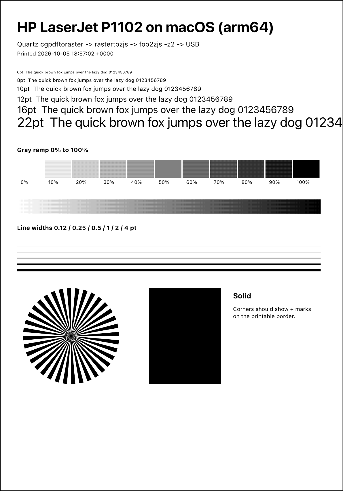

# HP LaserJet P1102 for macOS

[](https://github.com/rafay99-epic/hp-p1102-macos-driver/actions/workflows/ci.yml)

A working print driver for the HP LaserJet Professional P1102 on current macOS,
Apple Silicon and Intel. HP never shipped one for Apple Silicon, and macOS
doesn't include one. Once this is installed, the P1102 shows up in every app's
print dialog (<kbd>⌘P</kbd>) like any other printer.

<p align="center"></p>

## Why it needs a special driver

The P1102 is a host-based printer. It reports `CMD:ZJS,PJL`: it only accepts
pages that are already rasterised, in HP's ZjStream format. It has no
PostScript or PCL, so generic drivers send it nothing it can use.

This driver has macOS render each page, then converts it to ZjStream:

```
any app ⌘P → CUPS queue → cgpdftoraster → rastertozjs → foo2zjs → USB → P1102
                          (Apple, Quartz)  (this repo)   (vendored)
```

macOS renders the page with its own Quartz engine, so this needs no
Ghostscript, Homebrew or anything else at print time.

## Requirements

| | |
|---|---|
| Mac | Apple Silicon or Intel. The build makes one universal binary for both. |
| macOS | Tested on macOS 27 (Apple Silicon). Earlier versions should work but are untested. |
| To build | Xcode Command Line Tools (`xcode-select --install`) and git. Nothing else. |
| Printer | HP LaserJet Professional P1102, connected by USB |

## Install

```sh
git clone --recursive https://github.com/rafay99-epic/hp-p1102-macos-driver.git
cd hp-p1102-macos-driver
make            # build
make test       # optional: checks the whole print pipeline, no printer needed
sudo make install
```

`sudo make install` copies the driver to `/Library/Printers/HP-P1102`, adds the
PPD, and creates a print queue called **HP_LaserJet_P1102**. The printer can be
unplugged while you install.

Then plug the printer in, turn it on, and print a test page:

```sh
make print-test
```

There are no prebuilt downloads. The app isn't signed with an Apple Developer
ID, so building it yourself is the clean way to install it.

## Using it

Print from anything with <kbd>⌘P</kbd> and choose **HP LaserJet P1102**:
PDFs in Preview, Word, Excel and PowerPoint, Pages, Numbers, Keynote, web pages
from a browser. Color prints as grayscale.

| Option in the print dialog | Choices |
|---|---|
| Paper Size | A4 (default), US Letter, US Legal, Executive, A5, A6, JIS B5, envelopes #10, DL, C5, Monarch |
| Paper Type | Plain, Light, Heavy, Recycled, Rough, Labels, Envelope, Transparency |
| Print Density | 1 (lightest) to 5 (darkest) |
| Toner Save | Off / On |

The printer has no duplexer, so it can only print one side of the paper. It
prints at 600 dpi, and pages have a 4 mm (0.16 in) unprintable border.

## Commands

| | |
|---|---|
| `make` | Build universal binaries into `build/` |
| `make test` | Render A4, Letter and Legal test pages through the real macOS print pipeline and check the output |
| `make analyze` | Run the clang static analyzer |
| `sudo make install` | Install the driver and create the queue |
| `sudo make uninstall` | Remove the queue and every installed file |
| `make print-test` | Print a test page on the installed queue |
| `make help` | List all targets |

## Troubleshooting

**The green light blinks and nothing prints.** A job stopped partway and the
printer is still waiting for the rest of it. Turn the printer off and on.

**There are two P1102 printers in the print dialog.** macOS sometimes adds its
own queue when you plug the printer in. Remove the extra one in System Settings
→ Printers & Scanners. The one that works is **HP_LaserJet_P1102**.

**A job fails.** Turn on CUPS debug logging, print again, and read the log:

```sh
cupsctl --debug-logging
make print-test
grep -a rastertozjs /var/log/cups/error_log | tail -20
cupsctl --no-debug-logging
```

**The printer isn't found on USB.** Some units ship with HP Smart Install
turned on, which makes the printer show up as a CD drive instead. It has to be
turned off once from a Windows PC with HP's tool.

## Repository layout

```
driver/src/rastertozjs.c       CUPS filter: gray raster → black/white → foo2zjs
driver/ppd/                    PPD: paper sizes, options, printable area
driver/test/check.sh           pipeline tests used by `make test` and CI
vendor/foo2zjs/                ZjStream encoder (git submodule, unmodified)
tools/                         test page generator, PBM preview tool
```

CI builds, analyzes, tests, installs and uninstalls on every push and pull
request. Dependabot opens a PR each month if foo2zjs upstream or the action
versions change, and CI tests it before anything merges.

## Coming next

**PrinterBar**, a menu bar app that opens on its own when the printer is
plugged in. It shows the queue and lets you cancel jobs, print files and print
on both sides by hand. The design is in progress.

## Licence

foo2zjs is © Rick Richardson and contributors, GPL-2.0-or-later
([OpenPrinting/foo2zjs](https://github.com/OpenPrinting/foo2zjs)).
