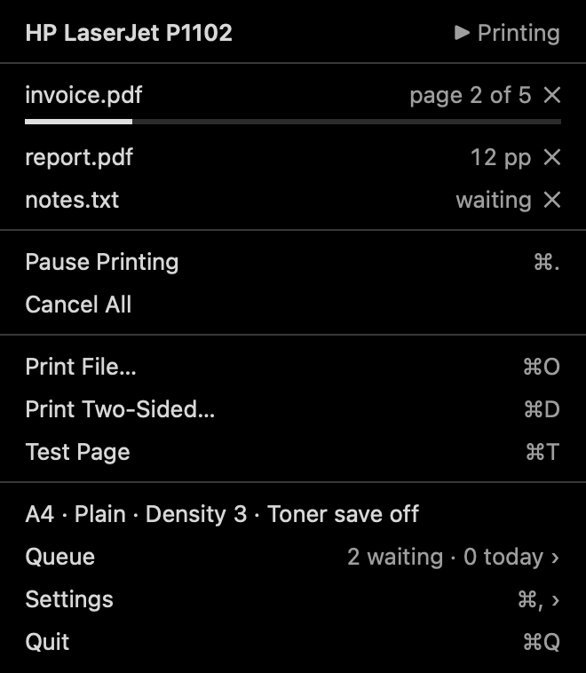
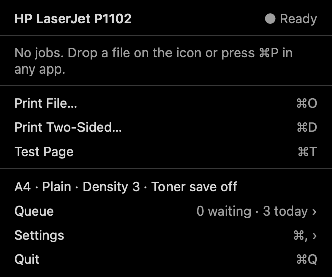
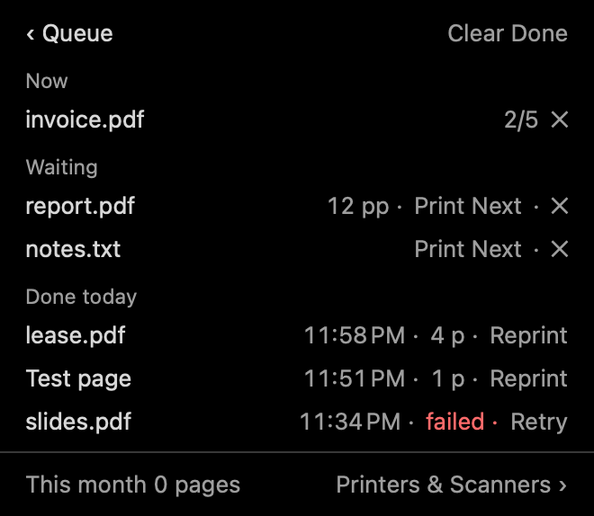
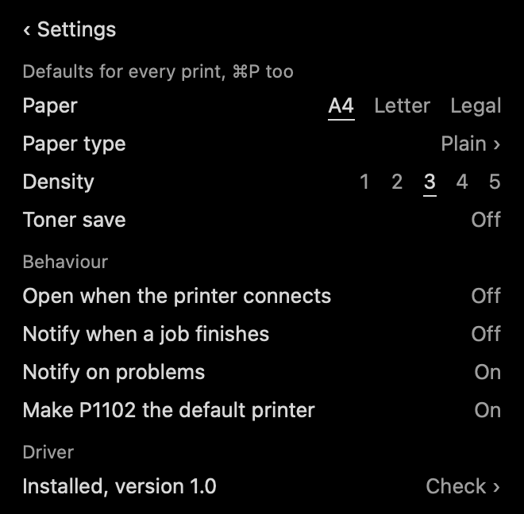
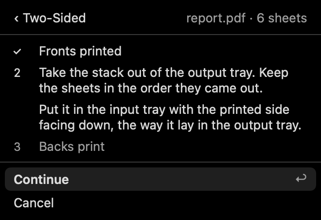
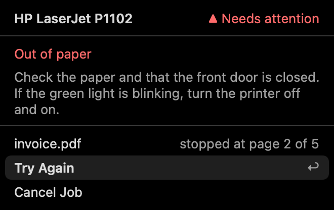
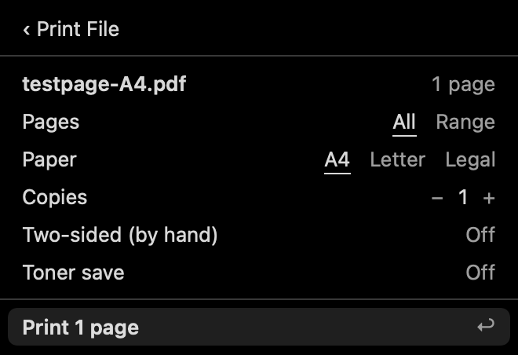

# HP LaserJet P1102 for macOS

[](https://github.com/rafay99-epic/hp-p1102-macos-driver/actions/workflows/ci.yml)

A working print driver for the HP LaserJet Professional P1102 on current macOS,
Apple Silicon and Intel, plus **PrinterBar**, a menu bar app that opens on its
own when you switch the printer on.

HP never shipped an Apple Silicon driver for the P1102, and macOS doesn't
include one. With this installed, the printer works from every app's print
dialog (<kbd>⌘P</kbd>) like any other printer.

<p align="center">
  
  &nbsp;
  
</p>

## Requirements

| | |
|---|---|
| Mac | Apple Silicon or Intel. Every build is universal. |
| macOS | Driver: tested on macOS 27; earlier versions should work but are untested. PrinterBar: macOS 14 or later. |
| To build | Xcode Command Line Tools (`xcode-select --install`) and git. PrinterBar also needs Xcode for Swift. |
| Printer | HP LaserJet Professional P1102, connected by USB |

There are no prebuilt downloads. The apps aren't signed with an Apple Developer
ID, so building them yourself is the clean way to install them.

## Install

```sh
git clone --recursive https://github.com/rafay99-epic/hp-p1102-macos-driver.git
cd hp-p1102-macos-driver
sudo make install      # driver + print queue
make install-app       # PrinterBar, copied to /Applications and opened
```

`sudo make install` copies the driver to `/Library/Printers/HP-P1102`, adds the
PPD and creates a print queue called **HP_LaserJet_P1102**. The printer can be
unplugged while you do this. PrinterBar can also install the driver for you:
its **Install Driver** button asks for your password and runs the same script.

Then switch the printer on and print a test page from PrinterBar, or with
`make print-test`.

## Printing

Print from anything with <kbd>⌘P</kbd> and choose **HP LaserJet P1102**: PDFs
in Preview, Word, Excel and PowerPoint, Pages, Numbers, Keynote, or web pages
from a browser. Color prints in grayscale.

| Option in the print dialog | Choices |
|---|---|
| Paper Size | A4 (default), US Letter, US Legal, Executive, A5, A6, JIS B5, envelopes #10, DL, C5, Monarch |
| Paper Type | Plain, Light, Heavy, Recycled, Rough, Labels, Envelope, Transparency |
| Print Density | 1 (lightest) to 5 (darkest) |
| Toner Save | Off / On |

The printer prints at 600 dpi and leaves a 4 mm (0.16 in) unprintable border.
It has no duplexer; PrinterBar walks you through two-sided printing by hand.

## PrinterBar

The menu bar icon appears when the printer is switched on and the app quits
when it's switched off. Nothing runs in the background in between: launchd
starts the app when the printer shows up on USB.

<p align="center">
  
  
  
</p>

- **Status and queue.** What's printing, page by page, what's waiting, and what printed today. Cancel, reprint, or move a job to the front.
- **Print files.** Drop files on the icon or use **Print File…** (<kbd>⌘O</kbd>). PDFs, images and text print directly. Word, PowerPoint, Excel and iWork files are handed to their own app, which prints them to the P1102.
- **Two-sided printing.** Prints the fronts, tells you how to reload the stack, then prints the backs. A one-time calibration sheet fixes the order for your setup. Hold <kbd>⌥</kbd> while dropping a PDF to print it two-sided.
- **Defaults.** Paper, paper type, density and toner save, saved on the print queue, so every app's <kbd>⌘P</kbd> uses them too.
- **Problems.** Out of paper, jams, or a job that stops making progress show up in red, with what to do about each.
- **Driver check.** Notices a missing driver or a second queue macOS added for the same printer, and repairs both.

<p align="center">
  
  
  
</p>

Menu bar icons, from left to right: ready, printing, paused, needs attention,
waiting for the printer.

<p align="center">
  
  
  
  
  
</p>

**Where's the icon?** On a MacBook with a notch, a full menu bar hides new
icons behind it. Hold <kbd>⌘</kbd> and drag other icons off the bar, or use a
menu bar manager.

To stop PrinterBar opening automatically, turn off **Open when the printer
connects** in its settings.

## Commands

| | |
|---|---|
| `make` | Build the driver (universal binaries in `build/`) |
| `make test` | Run A4, Letter and Legal test pages through the real macOS print pipeline and check the output. No printer needed. |
| `make analyze` | Run the clang static analyzer on the filter |
| `sudo make install` | Install the driver and create the queue |
| `sudo make uninstall` | Remove the queue and every driver file |
| `make print-test` | Print a test page on the installed queue |
| `make app` | Build `build/PrinterBar.app` (it bundles the driver for Install / Repair) |
| `make install-app` | Copy PrinterBar to `/Applications` and open it |
| `make app-test` | Run PrinterBar's unit tests |
| `make screens` | Render every PrinterBar screen to `docs/screens` |
| `make help` | List all targets |

## How it works

The P1102 is a host-based printer. It reports `CMD:ZJS,PJL`: it only accepts
finished bitmaps in HP's ZjStream format, with no PostScript or PCL. So the Mac
does all the rendering:

```
any app ⌘P → CUPS queue → cgpdftoraster → rastertozjs → foo2zjs → USB → P1102
                          (Apple, Quartz)  (this repo)   (vendored)
```

macOS renders the page with its own Quartz engine. `rastertozjs`, a small CUPS
filter written in C, turns it into black and white dots, and
[foo2zjs](https://github.com/OpenPrinting/foo2zjs) encodes those as ZjStream.
Nothing else is needed at print time: no Ghostscript, no Homebrew.

PrinterBar never touches the driver directly. It only talks to the CUPS queue,
so the driver works without the app, and the app shows "Driver missing"
without the driver.

## Troubleshooting

**The green light blinks and nothing prints.** A job stopped partway and the
printer is still waiting for the rest of it. Turn the printer off and on, then
choose **Try Again** in PrinterBar.

**There are two P1102 printers in the print dialog.** macOS sometimes adds its
own queue when you plug the printer in. PrinterBar's driver check removes it,
or remove it in System Settings → Printers & Scanners. The one that works is
**HP_LaserJet_P1102**.

**A job fails.** Turn on CUPS debug logging, print again, and read the log:

```sh
cupsctl --debug-logging
make print-test
grep -a rastertozjs /var/log/cups/error_log | tail -20
cupsctl --no-debug-logging
```

**The printer isn't found on USB.** Some units ship with HP Smart Install
turned on, which makes the printer show up as a CD drive instead. It has to be
turned off once from a Windows PC with HP's tool.

## Repository layout

```
driver/src/rastertozjs.c       CUPS filter: gray raster → black/white → foo2zjs
driver/ppd/                    PPD: paper sizes, options, printable area
driver/install.sh              installs the driver; used by make and PrinterBar
driver/test/check.sh           print pipeline tests (`make test`, CI)
app/Sources/PrinterBarKit/     CUPS access, queue settings, two-sided logic (tested)
app/Sources/PrinterBar/        menu bar app: USB watcher, launch agent, screens
vendor/foo2zjs/                ZjStream encoder (git submodule, unmodified)
tools/                         test page generator, PBM preview tool
```

CI builds everything for both architectures, runs the analyzer and both test
suites, installs the driver for real, tests PrinterBar against the installed
queue, renders every screen, and uninstalls. Dependabot opens a PR each month
if foo2zjs upstream or the action versions change.

## Licence

foo2zjs is © Rick Richardson and contributors, GPL-2.0-or-later
([OpenPrinting/foo2zjs](https://github.com/OpenPrinting/foo2zjs)).
